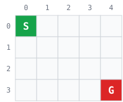
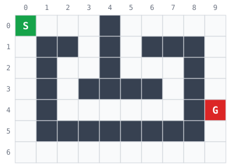
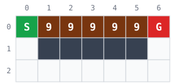
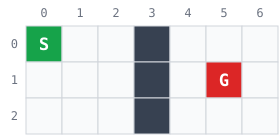

# Các mê cung mẫu của GridMaze

Trang này do `Source/tools/draw_mazes.py` sinh ra từ `MAZES` trong [`Source/bloxorz/maze.py`](../../Source/bloxorz/maze.py). Đừng sửa tay: sửa `MAZES` rồi chạy lại `python tools/draw_mazes.py` trong `Source/`.

Dùng để thử BFS, DFS, UCS, A* trước khi chạy Bloxorz (01 NV1, NV5–NV8). Kiểm tra tự động: `python -m unittest tests.test_solvers -v`. Xem nhanh trong terminal: `python -m bloxorz.maze`.

**Chú giải:** ô xám đậm là tường; ô trắng đi vào tốn 1; **S** (xanh) là xuất phát, **G** (đỏ) là đích, đi vào cũng tốn 1; ô vàng có chữ số 1–9 đi vào tốn đúng số đó (càng đậm càng tốn). Số trên đầu là cột, số bên trái là hàng: tọa độ (hàng, cột) như trong code. Thứ tự hành động: U, D, L, R.

## `open`



- Kích thước 4 × 5; xuất phát (0, 0), đích (3, 4).
- Đáp án: ít nhất **7** bước · chi phí nhỏ nhất **7**.
- Sân trống: mọi đường ngắn nhất đều dài 7.

```text
S....
.....
.....
....G
```

## `walls`



- Kích thước 7 × 10; xuất phát (0, 0), đích (4, 9).
- Đáp án: ít nhất **17** bước · chi phí nhỏ nhất **17**.
- Mê cung có nhiều nhánh và ngõ cụt: DFS có thể ra đường dài hơn BFS.

```text
S...#.....
.##.#.###.
.#..#...#.
.#.####.#.
.#......#G
.########.
..........
```

## `weighted`



- Kích thước 3 × 7; xuất phát (0, 0), đích (0, 6).
- Đáp án: ít nhất **6** bước · chi phí nhỏ nhất **10**.
- Đường ngắn nhất (6 bước) đi qua năm ô 9, tốn 46; đường vòng 10 bước tốn 10. UCS phải chọn đường vòng.

```text
S99999G
.#####.
.......
```

## `no_solution`



- Kích thước 3 × 7; xuất phát (0, 0), đích (1, 5).
- Đáp án: không có lời giải (`NO_SOLUTION`).
- Tường chắn kín: phải trả về NO_SOLUTION.

```text
S..#...
...#.G.
...#...
```
