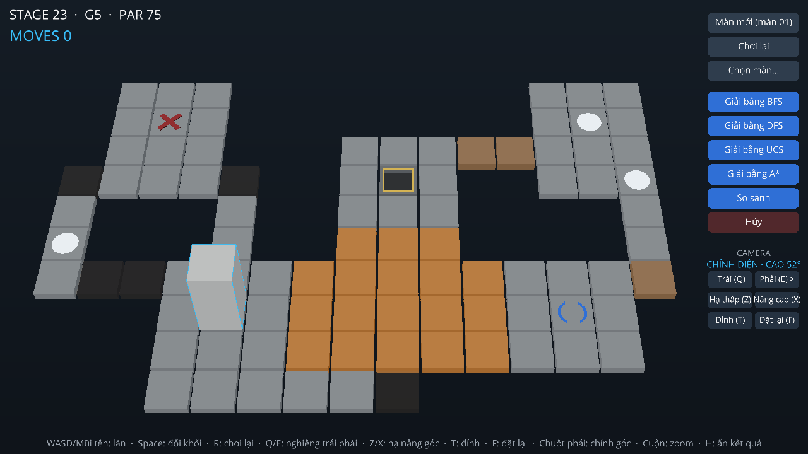
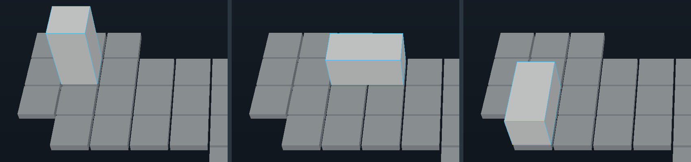
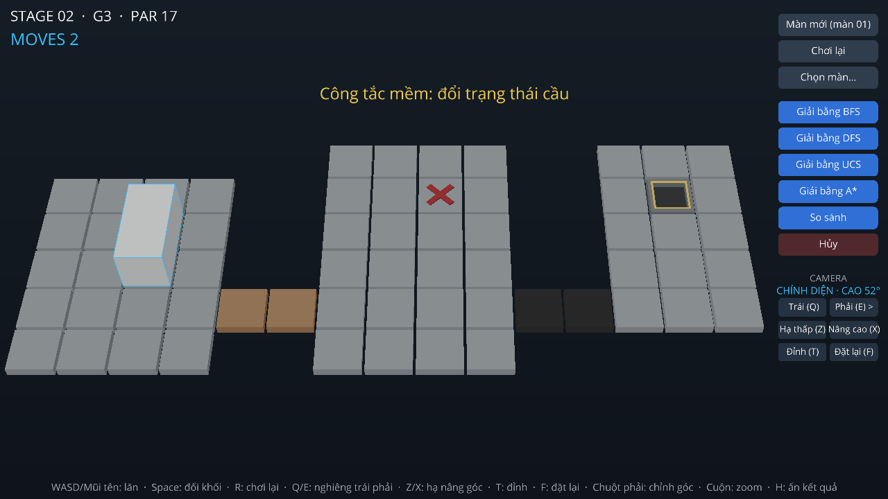
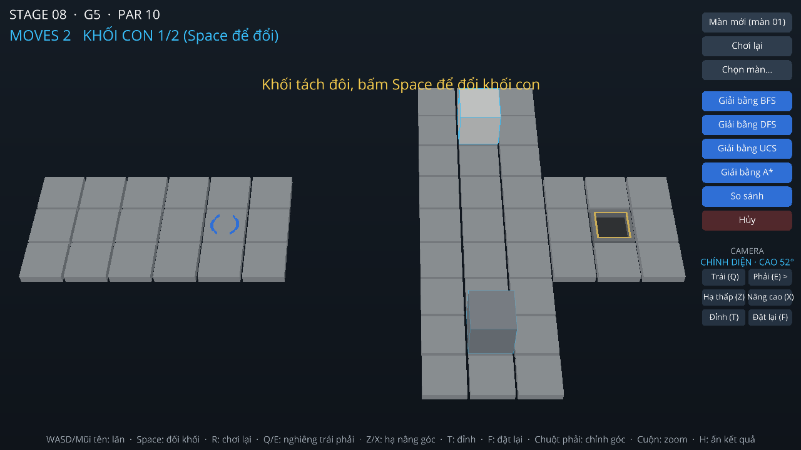
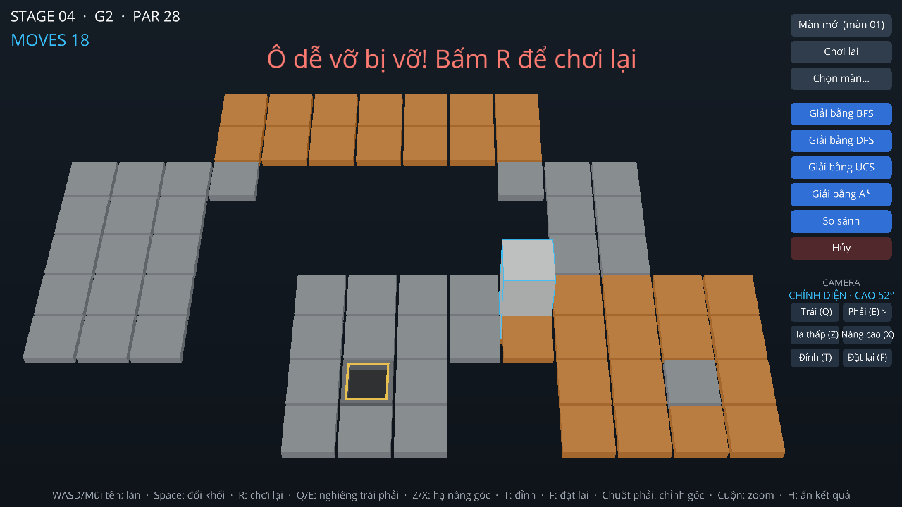
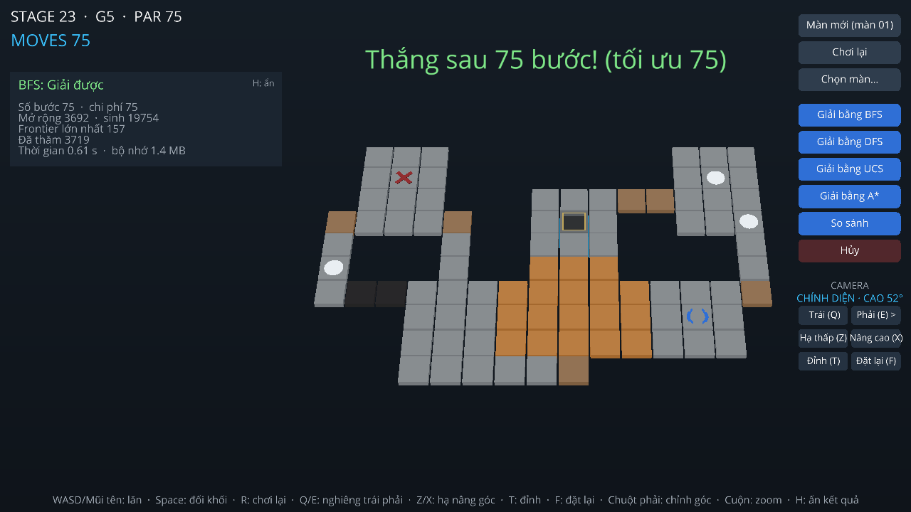
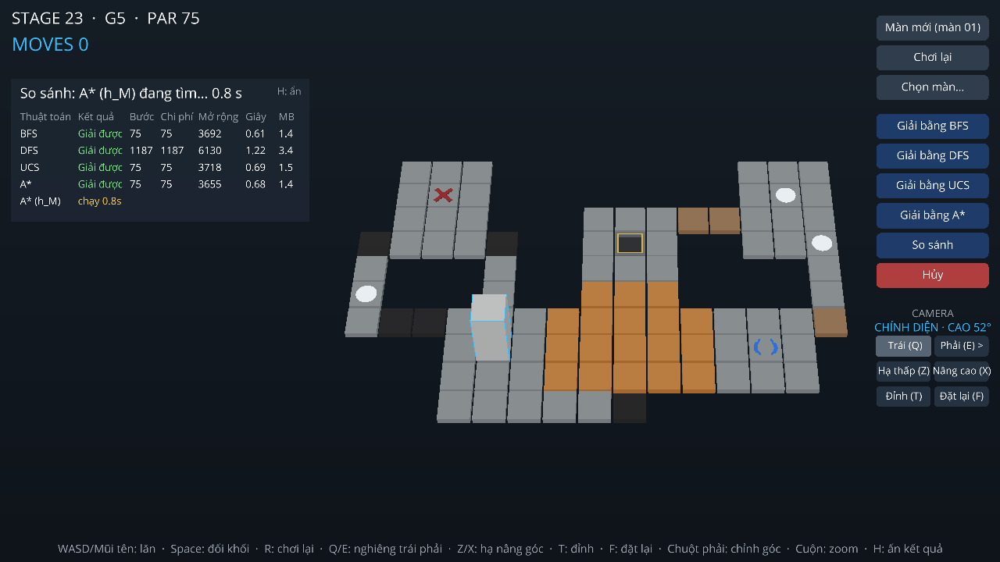
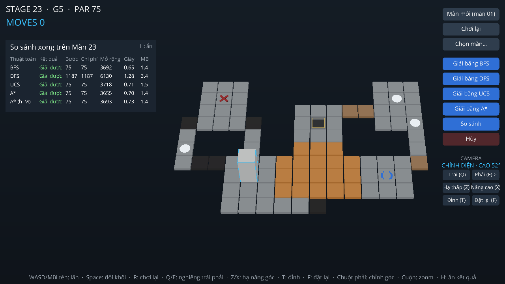
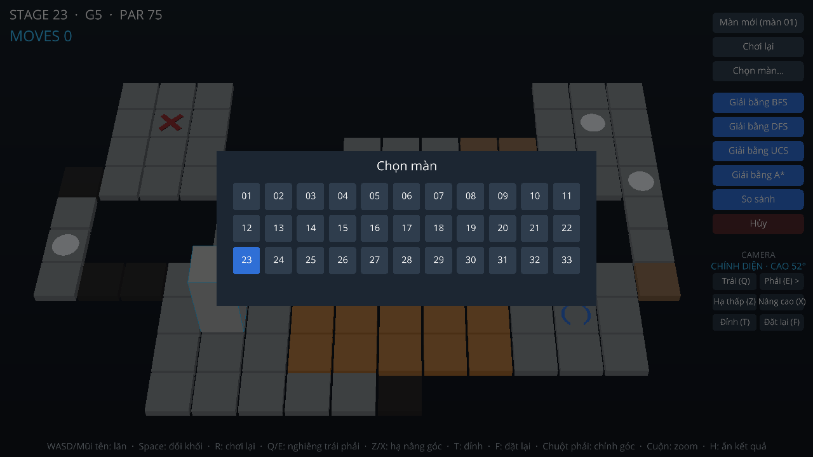
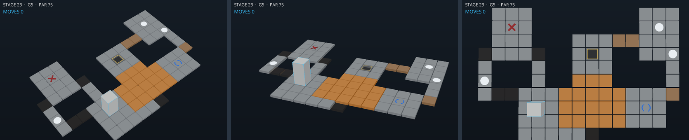

## 4. Cài đặt và giao diện

> Bản nháp của TV5 (V30), viết bằng tiếng Việt theo thuật ngữ ở docs/06 §2. TV4 chuyển vào bản ghép (V35). Số trích dẫn theo danh mục `tai-lieu-tham-khao.md` của TV4 ([8] nhóm khóa trước, [10] Ursina, [11] Panda3D). Ảnh chụp ngày 29/10/2026 trên bản ghép thử nhánh chính (a3d988b, đã có giao diện V21) với nhánh `integration/M2` (04d8a9a, có bộ nạp màn V03, UCS, hàm chi phí); đây cũng là nội dung của nhánh tích hợp `thu/test-main-m2`, trên đó cả 33 màn nạp được.

### 4.1. Công nghệ

Toàn bộ chương trình viết bằng **Python 3.11**. Giao diện 3D dùng **Ursina 7.0.0** [10], một engine game chạy trên **Panda3D 1.10.16** [11]. Nhóm chọn Ursina (bien-ban #3) vì ba lý do:

1. Cùng ngôn ngữ với engine và thuật toán, nên giao diện gọi thẳng hàm luật chơi của nhóm, không phải viết lại luật hay dựng thêm một lớp giao tiếp.
2. Bản demo đầu tiên dùng giao diện web (Three.js) gọi engine qua server HTTP. Cách đó đẹp hơn nhưng phải giữ thêm server, API và mã JavaScript; khi chuyển sang Ursina, phần này được bỏ.
3. Ursina đủ để dựng bàn 3D có hoạt ảnh lăn, tách, ghép và rơi. Một nhóm khóa trước cùng môn đã dùng Ursina cho đề tài này; nhóm tham khảo danh sách lỗi hay gặp của họ, không dùng lại code [8].

Ursina chạy trên Panda3D, mà Panda3D thường ra bản cho phiên bản Python mới chậm hơn. Vì vậy cả nhóm dùng chung Python 3.11, và `requirements.txt` ghim đúng phiên bản `ursina==7.0.0`, `panda3d==1.10.16` để máy chấm không cài nhầm bản mới hơn.

### 4.2. Cấu trúc thư mục và kiến trúc

```
Source/
  main.py            điểm vào: mở giao diện
  bloxorz/           engine luật chơi (state.py, level.py, rules.py, problem.py, costs.py, maze.py)
  solvers/           BFS, DFS, UCS, A*, heuristic; runner.py chạy solver ở tiến trình riêng
  gui/               giao diện Ursina (app.py, board_view.py, block_view.py, hud.py, camera_controller.py)
  levels/original/   33 màn gốc (JSON)
  tests/             unit test
```

Chương trình chia thành ba lớp, phụ thuộc theo một chiều:

| Package | Được dùng | Không được dùng |
|---|---|---|
| `bloxorz/` (engine) | thư viện chuẩn | `solvers`, `gui`, `ursina` |
| `solvers/` | `bloxorz` | `gui`, `ursina` |
| `gui/` | `bloxorz`, và từ `solvers` chỉ `ALGORITHMS` cùng module `runner` | gọi thẳng thuật toán |

Quy tắc này có hai hệ quả. Thứ nhất, **chơi tay và thuật toán dùng chung một hàm luật**: mỗi nước đi, dù do người bấm phím hay do khối tự lăn theo lời giải, đều qua `rules.step(level, state, action)`; giao diện không tự tính luật. Thứ hai, engine, thuật toán và test chạy được trên máy chưa cài Ursina, nên thực nghiệm và kiểm thử không phụ thuộc giao diện.

`step()` trả về `StepResult` gồm trạng thái mới, kết quả (`ok`, `fell`, `won`), vị trí ngay sau khi lăn (dùng cho hoạt ảnh) và danh sách sự kiện theo thứ tự xảy ra: công tắc tác động, ô dễ vỡ vỡ, tách, ghép, rơi, thắng. Giao diện chỉ đọc các trường này để vẽ.

Năm file của `gui/` chia việc như sau:

| File | Việc |
|---|---|
| `board_view.py` | Dựng bàn từ `Level`: mỗi ô một khối hộp; cầu đổi màu khi mở hoặc đóng; ô dễ vỡ rơi khi vỡ; viền ô đích nhấp nháy |
| `block_view.py` | Vẽ khối hoặc hai khối con theo `State`; hoạt ảnh lăn, tách, ghép, rơi |
| `hud.py` | Các nút, lưới chọn màn, khung kết quả và bảng So sánh |
| `camera_controller.py` | Góc nhìn: các nấc nghiêng, góc nhìn đỉnh, thu phóng, căn bàn khi khung kết quả hiện (mục 4.7) |
| `app.py` | Cửa sổ, phím, vòng `update()`; nối phím với `rules.step()` và nút với `runner` |

Tọa độ: ô ở hàng r, cột c có tâm tại x = c, z = −r trong không gian 3D, trục y hướng lên. Camera luôn đặt phía z âm, nhìn xuống bàn, nên phím ↑ (hàng giảm) luôn đẩy khối ra xa người xem.

### 4.3. Cài đặt và chạy

```bash
cd Source
python -m venv .venv
.venv\Scripts\activate
python -m pip install -r requirements.txt
python main.py          # mở màn 01; python main.py 17 mở thẳng màn 17
python -m unittest discover -v
```

Thuật toán chạy ở tiến trình riêng bằng `multiprocessing` kiểu `spawn`, nên `main.py` có `if __name__ == "__main__":` (bắt buộc trên Windows). `main.py` chỉ import giao diện bên trong hàm `main()`: tiến trình con nạp lại file này khi khởi động, và nếu Ursina được import ở đầu file thì mỗi lần bấm Giải sẽ chậm thêm khoảng một giây.

Đã thử cài theo các lệnh trên trong một môi trường ảo mới trên Windows 11: `pip` cài đúng hai phiên bản đã ghim, toàn bộ test qua và cửa sổ mở được.

### 4.4. Bàn chơi và các loại ô

Hình 4.1 là màn 23, màn duy nhất trong 33 màn gốc có đủ 9 loại ô. Mỗi loại ô có màu hoặc hình riêng (Bảng 4.1). Góc trên bên trái ghi mã màn, nhóm độ khó, số bước tối ưu tham khảo (PAR) và số bước đã đi (MOVES); cột nút ở bên phải; dòng dưới cùng tóm tắt các phím.



*Hình 4.1. Màn 23 lúc bắt đầu: đủ 9 loại ô trên cùng một bàn, phân biệt được bằng màu và hình mà không cần chú giải.*

*Bảng 4.1. Cách vẽ từng loại ô.*

| Ô | Ký hiệu trong file màn | Cách vẽ |
|---|---|---|
| Sàn, ô xuất phát | `#`, `S` | Khối hộp xám |
| Ô trống | `.` | Không vẽ gì |
| Đích | `G` | Lỗ vuông tối, viền vàng nhấp nháy nhẹ để dễ tìm |
| Ô dễ vỡ | `F` | Khối hộp cam |
| Công tắc mềm | `o` | Sàn có đĩa tròn trắng |
| Công tắc nặng | `x` | Sàn có hình X đỏ |
| Công tắc tách | `@` | Sàn có hình "( )" xanh |
| Cầu mở | `B` (hoặc `b` sau khi mở) | Khối hộp màu gỗ |
| Cầu đóng | `b` (hoặc `B` sau khi đóng) | Khối hộp sẫm, gần trong suốt, nhìn rõ chỗ có cầu |

Khối 1×1×2 màu trắng có viền xanh sáng để nổi trên sàn xám, và có ba tư thế (Hình 4.2). Kích thước khối nhỏ hơn ô một chút để luôn thấy viền giữa khối và sàn. Cảnh không dùng bóng đổ: bóng của khối phủ lên ô làm màu ô khó phân biệt, nhất là ô dễ vỡ và cầu đóng.



*Hình 4.2. Ba tư thế của khối ở màn 1: đứng chiếm một ô, nằm ngang (sau phím →) và nằm dọc (sau phím ↓) chiếm hai ô.*

Khi công tắc tác động, cầu bị điều khiển đổi màu dần giữa màu gỗ và màu sẫm, kèm một dòng thông báo cho biết loại công tắc và hiệu ứng (Hình 4.3). Thông báo lấy từ sự kiện `switch` của engine, không do giao diện tự suy ra.



*Hình 4.3. Màn 2, bước 2: khối nằm vừa chạm công tắc mềm nên cặp cầu bên trái mở; cặp cầu bên phải vẫn đóng cho tới khi khối đứng lên công tắc nặng (dấu X đỏ).*

Khi khối đứng lên công tắc tách, hai khối con bay ra từ chỗ khối cũ tới hai ô định sẵn (Hình 4.4). Khối con đang điều khiển màu trắng, viền xanh rõ; khối còn lại màu xám, viền mờ; phím Space đổi khối. Engine luôn sắp hai khối con theo thứ tự ô, nên sau mỗi bước, giao diện tìm lại khối vừa đi theo ô mới của nó để giữ đúng khối người chơi đang điều khiển. Hai khối con kề nhau thì tự ghép lại, có thông báo.



*Hình 4.4. Màn 8 sau khi tách: khối con sáng màu là khối đang điều khiển (ghi "KHỐI CON 1/2" cạnh số bước).*

Khối rơi khi chạm ô trống, ra ngoài bàn, vào cầu đóng, hoặc đứng thẳng trên ô dễ vỡ. Giao diện hiện lý do rơi; với ô dễ vỡ, ô cam rơi cùng khối (Hình 4.5) và được dựng lại khi bấm R.



*Hình 4.5. Màn 4: khối đứng thẳng lên ô dễ vỡ, ô vỡ và đang rơi cùng khối; thông báo nêu đúng lý do thua.*

### 4.5. Chơi tay

| Phím | Tác dụng |
|---|---|
| ← ↑ → ↓ hoặc W A S D | Lăn khối |
| Space | Đổi khối con (khi đã tách) |
| R | Chơi lại màn |
| N / P | Màn sau / màn trước |
| Q / E, Z / X, T, F, chuột phải, con lăn | Đổi góc nhìn (mục 4.7) |
| H | Ẩn hoặc hiện khung kết quả (mục 4.7) |
| Esc | Đóng lưới chọn màn |

Một lượt đi diễn ra theo thứ tự: phím được đổi thành hành động và gửi vào `rules.step()`; khối trượt tới vị trí ngay sau khi lăn; sau đó giao diện cập nhật cầu, hiện thông báo sự kiện, rồi vẽ trạng thái cuối (tách, ghép, rơi hoặc thắng). Trong lúc hoạt ảnh chạy, phím mới bị bỏ qua, để trạng thái giao diện đang giữ không đi trước hình đang vẽ. Mỗi lần chơi lại hoặc đổi màn, giao diện tăng một số đếm lượt; lệnh hẹn giờ nào của lượt cũ còn sót lại thấy số đếm đã đổi thì bỏ qua, nên bấm R giữa lúc khối đang lăn không làm trạng thái cũ ghi đè lên màn vừa chơi lại.

Mọi đối tượng của một màn gắn vào một gốc chung; đổi màn thì hủy gốc này, nên bàn cũ không còn sót lại. Đây là một trong các lỗi hay gặp với Ursina mà nhóm khóa trước ghi lại [8].

### 4.6. Giải tự động và So sánh

Cột nút bên phải gồm Màn mới, Chơi lại, Chọn màn (Hình 4.9), bốn nút Giải bằng BFS, DFS, UCS, A*, nút So sánh, nút Hủy và nhóm nút camera.

**Chạy thuật toán không làm đơ giao diện.** Ursina vẽ mọi thứ trong một vòng lặp duy nhất, nên nếu chạy thuật toán ngay trong vòng lặp đó thì cửa sổ đứng yên suốt lúc tìm. Khi bấm một nút Giải, giao diện gọi `runner.start_solver()`; hàm này mở một tiến trình con chạy thuật toán rồi trả về ngay. Mỗi khung hình, giao diện gọi `poll()` để hỏi kết quả mà không phải chờ; không dùng callback từ tiến trình khác, vì Ursina không an toàn khi đối tượng bị sửa ngoài luồng chính. Dùng tiến trình chứ không dùng luồng vì Python không dừng ngang được một luồng: quá 60 giây hoặc khi bấm Hủy, tiến trình con bị dừng hẳn. Trong lúc chờ, khung kết quả hiện tên thuật toán và số giây đã chạy, các nút Giải mờ đi và nút Hủy sáng lên (Hình 4.7). Khi đo trong lúc thuật toán chạy, khung hình chậm nhất khoảng 55 ms, tức cửa sổ vẫn phản hồi.

Mỗi lần giải có bốn kết quả, mỗi loại một thông báo và màu riêng: **giải được**, **không có lời giải**, **hết giờ**, **lỗi hoặc đã hủy**. Khi giải được, màn được đặt lại về trạng thái đầu và khối tự lăn theo lời giải, mỗi bước cũng qua `rules.step()` như khi chơi tay. Khung kết quả ở cột bên trái hiện số bước, tổng chi phí, số nút được mở rộng và được sinh, kích thước biên lớn nhất, số trạng thái đã thăm, thời gian tìm kiếm (không tính thời gian hoạt ảnh) và bộ nhớ đỉnh (Hình 4.6).



*Hình 4.6. Màn 23 sau khi bấm Giải bằng BFS: khối đã tự lăn tới đích sau 75 bước, đúng số bước tối ưu; khung kết quả hiện các chỉ số của lần tìm, bàn thu nhỏ vào phần màn hình còn trống nên không bị che.*

**So sánh** chạy lần lượt năm thuật toán trên màn đang mở: BFS, DFS, UCS, A* với h_P và A* với h_M (bien-ban #15), mỗi thuật toán một tiến trình. Chạy lần lượt chứ không song song để thời gian và bộ nhớ của các thuật toán không ảnh hưởng nhau. Bảng được điền dần khi từng thuật toán xong (Hình 4.7, 4.8); dòng đang chạy ghi số giây đã chạy; thuật toán nào lỗi thì ô ghi "Lỗi" và nội dung lỗi ghi dưới bảng. Cột "Giây" và "MB" ghi số không kèm đơn vị cho bảng gọn.



*Hình 4.7. So sánh đang chạy trên màn 23: bốn thuật toán đã xong, A* với h_M đang chạy; nút Hủy sáng, các nút Giải tạm khóa.*



*Hình 4.8. Kết quả So sánh trên màn 23: BFS, UCS và A* với cả hai heuristic cùng tìm được lời giải 75 bước; DFS tìm được lời giải dài 1187 bước, đúng với việc DFS không bảo đảm đường ngắn nhất.*

Thời gian và bộ nhớ trên giao diện chỉ để tham khảo, vì tiến trình con luôn bật `tracemalloc` để đo bộ nhớ, và việc này làm chậm thuật toán. Số liệu ở chương 5 lấy từ script thực nghiệm.



*Hình 4.9. Lưới chọn màn: màn đang mở tô màu xanh; bấm một mã màn để chuyển thẳng tới màn đó, thuật toán đang chạy (nếu có) bị hủy. Bấm ra ngoài lưới hoặc Esc để đóng.*

### 4.7. Camera và bố cục màn hình

Camera xoay quanh tâm bàn và **luôn nhìn từ trên xuống, từ phía người chơi**. Nếu cho xoay tự do 360°, người chơi dễ lẫn hướng: khi camera quay quá 45°, phím ↑ không còn đẩy khối "ra xa màn hình" nữa. Vì vậy góc nhìn chỉ đổi trong vùng giới hạn (Hình 4.10):

- **Nghiêng trái, phải** (Q / E): năm nấc 40° trái, 20° trái, chính diện, 20° phải, 40° phải. Góc lệch luôn dưới 45° nên bốn phím mũi tên giữ nguyên nghĩa trên màn hình, giao diện không phải đổi lại hướng phím.
- **Hạ thấp, nâng cao** (Z / X): góc giữa mặt bàn và hướng nhìn có bốn nấc 52°, 45°, 38°, 30°. Góc thấp thấy rõ khối đứng và độ cao của khối, góc cao thấy rõ toàn bàn; người chơi chọn nấc thấy dễ nhìn.
- **Nhìn từ đỉnh** (T): nhìn thẳng xuống, bàn thẳng hàng với màn hình; bấm T lần nữa thì trở về góc trước đó. Góc đỉnh đặt 88,5° chứ không đúng 90° để phép tính hướng nhìn không bị suy biến.
- **Kéo chuột phải** chỉnh góc liên tục nhưng vẫn trong vùng trên; **con lăn** thu phóng; **F** về góc mặc định (chính diện, 52°). Góc đã chọn được giữ khi đổi màn.

Camera chuyển góc mượt bằng nội suy mỗi khung hình. Khi nghiêng ngang, camera lùi xa thêm một chút vì bàn chiếm chỗ theo đường chéo; hướng "lên" của camera luôn ghim theo trục y nên hình không bị xoay nghiêng dần sau nhiều lần đổi góc. Tên góc đang dùng (ví dụ "CHÍNH DIỆN · CAO 52°") hiện trên nhóm nút camera.



*Hình 4.10. Màn 23 ở ba góc nhìn: nghiêng trái 40° (cao 52°), nghiêng phải 20° hạ thấp còn 30°, và nhìn từ đỉnh. Ở cả ba góc, phím ↑ vẫn đẩy khối về phía trên màn hình.*

**Bố cục khi khung kết quả hiện.** Khung kết quả nằm ở cột bên trái, cột nút ở bên phải. Khi khung hiện, camera lùi xa và dời hình sang phải (bằng độ lệch ống kính, góc nhìn không đổi) để bàn nằm gọn giữa khung và cột nút, không bị che (Hình 4.6, 4.8). Phím H ẩn khung để xem bàn ở cỡ đầy đủ; kết quả lần giải mới luôn hiện lại khung.

### 4.8. Kiểm thử giao diện

Ngoài unit test của engine và thuật toán (không cần Ursina), giao diện được thử bằng các script mở cửa sổ thật và tự bấm phím, bấm nút thay người chơi. Các dòng có ghi 29/10 được chạy lại trên giao diện hiện tại; các dòng còn lại chạy ngày 23/10 và phần code liên quan chưa đổi từ đó.

| Kiểm tra | Kết quả |
|---|---|
| Chơi tay theo lời giải BFS ở màn 2, 4, 8 (cầu, ô dễ vỡ, tách và ghép) | Thắng đúng 17, 28, 10 bước |
| Đứng lên ô dễ vỡ ở màn 4, rồi bấm R | Rơi, đúng thông báo; ô được dựng lại |
| Bấm R giữa lúc khối đang lăn | Không bị lượt cũ ghi đè |
| Giải bằng BFS rồi tự lăn, trên cả 33 màn (29/10) | 33/33 màn thắng đúng số bước tối ưu |
| Giải bằng DFS rồi tự lăn ở màn 1, 8, 16, 23, 29 | Thắng ở cả 5 màn (màn 23: 1187 bước) |
| So sánh trên cả 33 màn | 33/33 màn đủ năm dòng kết quả |
| So sánh trên màn 23 (29/10) | Đủ năm dòng; BFS, UCS, A* (h_P), A* (h_M) 75 bước, DFS 1187 bước |
| Bấm Hủy khi đang giải và khi đang So sánh; đổi màn khi đang giải | Dừng đúng; các nút trở lại trạng thái ban đầu |
| Đổi qua mọi nấc Q/E, Z/X, T rồi F (29/10) | Camera dừng đúng nấc, hình không bị xoay nghiêng; F về chính diện 52° |
| Khung kết quả hiện, rồi bấm H (29/10) | Bàn thu vào phần còn trống, không bị che; ẩn khung thì bàn về cỡ đầy đủ |
| Cài trong môi trường ảo mới theo README | Cài đúng phiên bản, test qua, cửa sổ mở được |

### 4.9. Hạn chế

- Khối trượt giữa hai vị trí chứ chưa lật quanh cạnh như game gốc.
- Chưa có màn hướng dẫn chú giải các loại ô và phím; người chơi xem Bảng 4.1, dòng phím tắt cuối màn hình hoặc README.
- Chưa chỉnh được tốc độ khối tự lăn và chưa tạm dừng được giữa chừng (chỉ dừng hẳn bằng Hủy hoặc R).
- Menu chọn màn chỉ có 33 màn gốc; bộ màn tự sinh S1–S3 (chương 5) chưa mở được từ giao diện.
