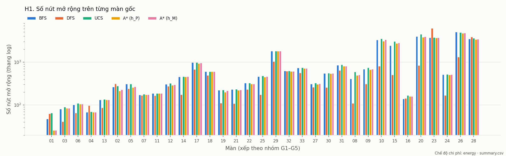
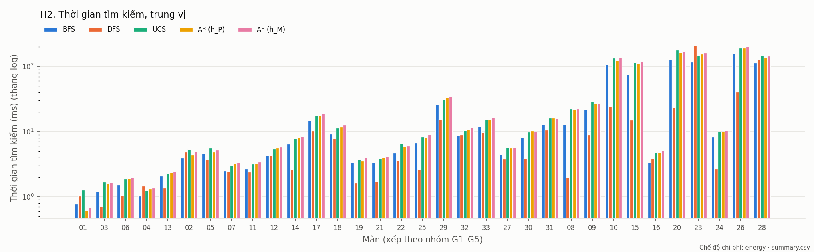
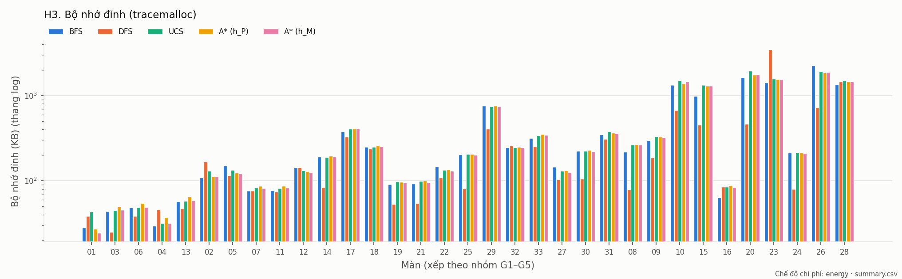
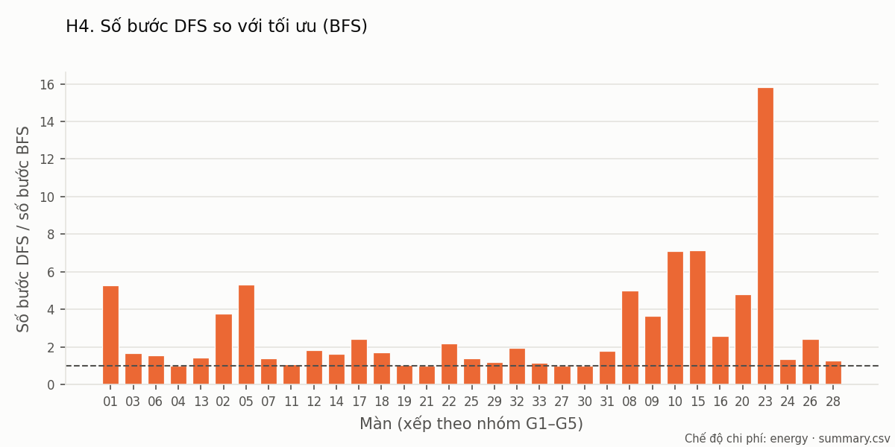
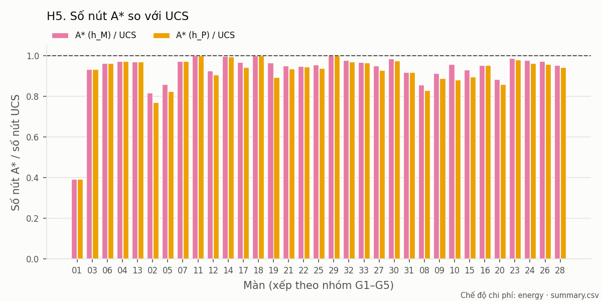
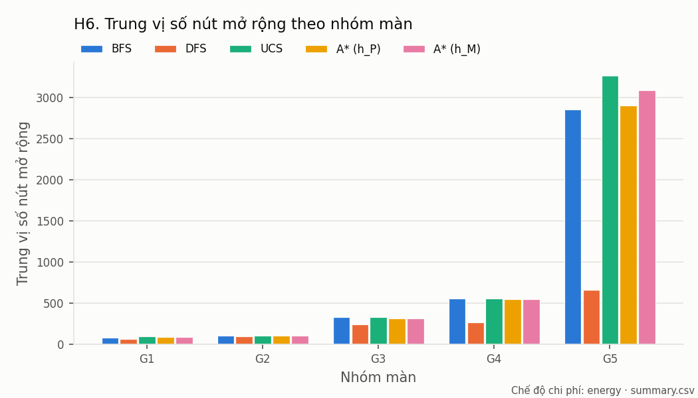
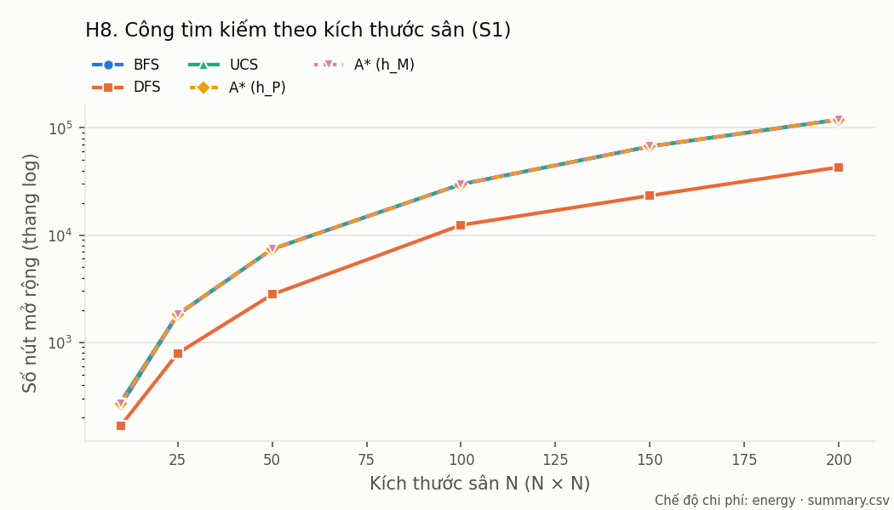
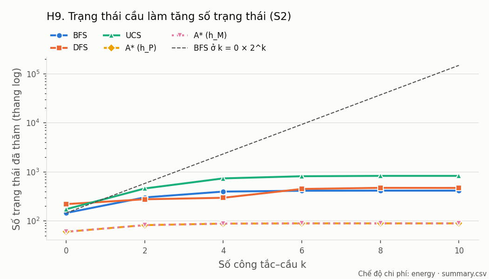

## 5. Thực nghiệm

> Nháp của TV2 (V27, V32), cập nhật 31/10 với số liệu đo ngày 31/10, commit `0a35afd`. Trạng thái:
> - **Đã có số liệu:**
>   - đo theo đúng phương pháp 04 §4 (5 lần đo thời gian, 1 lần đo bộ nhớ, timeout 60 giây) trên commit sạch, chế độ chi phí `energy` (V13);
>   - K1–K8 đều PASS;
>   - chạy lại lần thứ hai trên cùng commit, số đếm trùng hẳn ở 235/235 cặp;
>   - dữ liệu, hình và bảng ở `Source/experiments/benchmark-2026-10-31-0a35afd/`.
> - **Chi phí bước làm khối tách đôi: 1,62.** Trước commit `0a35afd`, bảng năng lượng trong `costs.py` không có cặp tư thế nằm → tách, nên bước này rơi về mức mặc định 1,0, rẻ hơn mọi bước khác. TV2 áp dụng mức 1,62 (bằng nằm → đứng, vì khối chỉ tách khi đứng lên công tắc tách) để hoàn thiện phép đo (PR #23). Đây là quyết định được áp dụng để hoàn thiện phép đo; **TV3 (phụ trách `costs.py`) chưa review hay phê duyệt**, và Bảng 2.7 (TV1) chưa có dòng cho bước này. Nếu nhóm chọn mức khác, chỉ 10 màn nhóm G5 bị ảnh hưởng, ở hai loại số liệu:
>   - cột tổng chi phí của mọi thuật toán;
>   - số đếm, thời gian, bộ nhớ của UCS và A*.
>
>   Số liệu của G1–G4, S1–S3, và số bước, số đếm, bộ nhớ của BFS và DFS ở mọi màn đều không phụ thuộc. Lần đo trước trên commit `cd93624` (bước tách 1,0) được thay hẳn; khác biệt giữa hai lần ghi ở cuối mục 5.3.
> - **Định dạng kết quả:** chương này chỉ dùng 16 cột của `summary.csv` đã chốt ở 04 §5. Các bổ sung về định dạng file kết quả (Q1–Q7) chưa được ghi vào `docs/04`, nhưng không ảnh hưởng số liệu trong chương.
> - **5.4:** mỗi chủ thuật toán viết một đoạn (5.4.1 BFS, 5.4.2 DFS, 5.4.3 UCS, 5.4.4 A*), file riêng.

### 5.1. Thiết lập thực nghiệm

**Câu hỏi cần trả lời** (04 §1):

1. Thuật toán nào mở rộng ít nút nhất, chạy nhanh nhất, tốn ít bộ nhớ nhất, và khác biệt thay đổi thế nào theo nhóm màn G1–G5?
2. Chất lượng lời giải: số bước và tổng chi phí so với tối ưu.
3. Công tắc và cầu làm không gian trạng thái lớn lên bao nhiêu (nhóm S2)?
4. Mỗi heuristic của A* ($h_M$, $h_P$) bớt được bao nhiêu nút so với UCS?
5. Số nút, thời gian và bộ nhớ tăng thế nào khi bàn lớn dần (S1), và khi màn không có lời giải (S3)?

**Thuật toán.** Năm cấu hình, dùng chung một engine luật, một hàm chi phí và một thứ tự hành động (U, D, L, R; khi đã tách U1 … R1, U2 … R2):

| Khóa | Thuật toán | Kiểm tra đích | Chương |
|---|---|---|---|
| `bfs` | BFS | khi sinh nút | 3.1 |
| `dfs` | DFS dạng tìm kiếm trên đồ thị | khi sinh nút | 3.2 |
| `ucs` | UCS | khi lấy ra khỏi hàng đợi | 3.3 |
| `astar` | A* với $h_P$ (heuristic chính) | khi lấy ra khỏi hàng đợi | 3.4 |
| `astar_m` | A* với $h_M$ (để so sánh) | khi lấy ra khỏi hàng đợi | 3.4 |

Thời điểm kiểm tra đích làm thay đổi số nút mở rộng: BFS và DFS dừng ngay khi sinh ra đích, còn UCS và A* phải chờ tới lúc lấy đích ra để giữ tính tối ưu. Khi đọc bảng, cần nhớ điều này.

**Chỉ số.** Bốn chỉ số đề bắt buộc (thời gian tìm kiếm, bộ nhớ đỉnh, số nút mở rộng, độ dài lời giải), cộng năm chỉ số để giải thích kết quả.

**Bảng 5.1.** Các chỉ số đo (định nghĩa đầy đủ ở 04 §2, quy ước đếm ở 04 §3).

| Chỉ số | Cột trong `summary.csv` | Định nghĩa |
|---|---|---|
| Số bước | `steps` | Số lần lăn trong lời giải, gồm cả bước của khối con |
| Tổng chi phí | `path_cost` | Tổng chi phí bước dọc lời giải, theo **cùng một** hàm chi phí cho cả 5 cấu hình |
| Số nút mở rộng | `expanded` | Số trạng thái được lấy ra khỏi biên để sinh con. **Chỉ số chính khi so sánh** |
| Số nút sinh | `generated` | Số trạng thái con hợp lệ, đếm trước khi xét tập đã thăm |
| Biên lớn nhất | `max_frontier` | Số phần tử lớn nhất từng có trong biên. UCS và A* tính cả mục cũ còn trong heap (lazy deletion) |
| Trạng thái đã thăm | `visited` | Kích thước tập đã thăm lúc kết thúc |
| Bộ nhớ đỉnh | `peak_mem_kb` | Đỉnh bộ nhớ Python cấp phát trong `prepare()` và `search()`, đo bằng `tracemalloc` |
| Thời gian tìm kiếm | `search_ms` | Thời gian chạy `search()`, trung vị 5 lần |
| Tổng thời gian | `total_ms` | Từ lúc đọc file màn tới khi có lời giải: nạp màn, dựng bài toán, `prepare()`, `search()`; trung vị 5 lần |
| Kết quả | `status` | `solved`, `no_solution`, `timeout`, `invalid` |

**Cách đo.** Script `Source/experiments/run.py` (TV2, việc V23) cài đúng 04 §4:

- **Mỗi lần chạy là một tiến trình con riêng** (`multiprocessing`, kiểu `spawn`), có giới hạn 60 giây. Nhờ vậy, hết giờ thì dừng được tiến trình một cách an toàn, và bộ nhớ của lần chạy trước không dồn sang lần sau.
- **Thời gian:** đo 5 lần bằng `time.perf_counter_ns()`, gọi `gc.collect()` trước mỗi lần, **không** bật `tracemalloc`; lấy trung vị, làm tròn 2 chữ số thập phân. `tracemalloc` làm chương trình chậm đi đáng kể, nên đo thời gian khi đang bật nó thì không tách được chi phí của thuật toán khỏi chi phí của việc đo.
- **Bộ nhớ:** chạy thêm một lần riêng. `tracemalloc.start()` ngay trước `prepare()`, đọc giá trị đỉnh ngay sau `search()`; thời gian của lần này bị bỏ.
- **Hàm chi phí:** với `--cost energy`, script dựng `Problem(level, cost_fn=compute_step_cost)` (`Source/bloxorz/costs.py`, Bảng 2.7). Cả năm cấu hình đọc chi phí qua cùng một hàm `Problem.step_cost`:
  - UCS và A* cộng chi phí này khi mở rộng nút;
  - BFS và DFS không dùng nó khi chọn nút, chỉ dùng để tính tổng chi phí của lời giải.

  `run_info.json` ghi chế độ chi phí ở khóa `cost`. Với `--cost unit`, mỗi bước tốn 1.
- **Kiểm tra lời giải:** sau khi đo, phát lại lời giải bằng engine từ trạng thái đầu và tính lại tổng chi phí. Không tới đích, hoặc tổng chi phí lệch với solver báo, thì ghi `invalid`. Chi phí V13 là số lẻ, nên tổng chi phí được so tương đối (sai lệch tương đối tối đa $10^{-9}$): solver và bước phát lại cộng theo thứ tự khác nhau. Bước phát lại nằm ngoài phần đo thời gian.
- **Nguồn gốc số liệu:** `run_info.json` ghi commit Git, cấu hình máy, các tham số chạy, mã băm sha256 của từng file màn, và đánh dấu `-dirty` nếu mã nguồn hoặc file màn khác với commit.

**Bảng 5.2.** Thiết lập của lần chạy chính thức (T1).

| Hạng mục | Giá trị |
|---|---|
| CPU, RAM | AMD64 Family 25 Model 117 (16 luồng), 15,3 GB |
| Hệ điều hành | Windows (`platform`: Windows-10-10.0.26200-SP0) |
| Python | CPython 3.11.9 |
| Commit Git | `0a35afd`, không có thay đổi chưa commit (`dirty_reasons` rỗng) |
| Số lần đo thời gian | 5, lấy trung vị |
| Số lần đo bộ nhớ | 1, chạy riêng |
| Giới hạn thời gian | 60 giây mỗi lần chạy |
| Hàm chi phí | V13 (`bloxorz/costs.py`, Bảng 2.7, mục 3.3), bước tách khối 1,62; `run.py --cost energy`, kiểm khóa `cost` trong `run_info.json` |
| Thời gian chạy toàn bộ | 9 phút 34 giây (04:43:38 → 04:53:12 UTC, 31/10/2026) |
| Cảnh báo, lần đo bộ nhớ thất bại | 0, 0 |

**Hàm chi phí.** Cột `path_cost` của cả năm cấu hình tính theo cùng một hàm chi phí V13 (Bảng 2.7, mục 3.3), để so được chất lượng lời giải.

**Kiểm tra chức năng của hàm chi phí** (kiểm tính đúng, không phải số liệu hiệu năng; chạy trên commit `0a35afd`):
- Công cụ `tools/check_heuristics.py` (TV4) với chi phí V13: 0 vi phạm chấp nhận được và 0 vi phạm nhất quán của $h_M$ và $h_P$. Phạm vi kiểm: 340 414 cạnh của 33 màn gốc, 2 015 147 cạnh của 14 màn tự sinh. Tổng chi phí của A* bằng UCS ở mọi màn.
- Test `tests/test_costs_split.py` duyệt mọi cạnh tới được của 33 màn gốc. Mọi cặp tư thế đều có trong bảng năng lượng, không cạnh nào rơi về mức mặc định. Chi phí bằng bảng cộng phụ phí ô dễ vỡ, mọi bước có chi phí ít nhất 1 (đúng điều kiện ở mục 2.8), và không có cạnh đứng → tách. Test cũng kiểm: bước tách trên lời giải UCS của màn 08 tốn đúng 1,62; ở cả 10 màn G5, tổng chi phí của 5 cấu hình bằng chi phí phát lại.

Riêng **số bước và các số đếm của BFS và DFS không phụ thuộc hàm chi phí**, vì hai thuật toán này không dùng chi phí khi chọn nút. Ngược lại, số liệu của UCS và A* sẽ thay đổi khi đổi hàm chi phí.

**Kiểm tra chéo trước khi dùng số liệu** (04 §6). Một dòng sai là dấu hiệu lỗi trong engine hoặc thuật toán; sửa xong mới đưa số liệu vào báo cáo.

- Mọi lời giải phát lại đều tới đích, không có dòng `invalid` hay lỗi.
- Số bước của BFS bằng cột "Bước tối ưu" (03 §4) ở cả 33 màn.
- Số bước của DFS, UCS, A* không nhỏ hơn của BFS.
- Tổng chi phí của UCS bằng A* ở mọi màn, với cả $h_M$ và $h_P$.
- Tổng chi phí của BFS và DFS không nhỏ hơn của UCS.
- Số nút mở rộng của A* không lớn hơn UCS.
- Màn không có lời giải (S3): mọi thuật toán trả `no_solution`.
- Đủ dòng (01 NV10): 33 màn gốc × 5 cấu hình cùng các màn tự sinh, không thiếu cặp nào; mọi dòng của màn gốc là `solved`, vì màn gốc nào cũng có lời giải.

Các mục trên được kiểm tự động bằng `experiments/check_results.py` (K1–K8). Kiểm tra "đặt mọi chi phí bằng 1 thì UCS bằng BFS" nằm ở test của UCS. Kiểm tra "0 vi phạm heuristic" nằm ở `tools/check_heuristics.py`.

**Kết quả trên lần đo ngày 31/10:**
- **K1–K8 đều PASS** (`check_results.txt`).
- **Tái lập:** chạy lại lần hai trên cùng commit; `compare_runs.py` cho số đếm trùng hẳn ở 235/235 cặp. Thời gian tìm kiếm lần hai so với lần một có tỉ lệ trung vị 1,03 (thấp nhất 0,93, cao nhất 1,19); bộ nhớ đỉnh trùng hẳn.
- **Kiểm tra độc lập** (`kiem_tra_doc_lap.py`, không dùng công cụ sinh bảng):
  - phát lại 225 lời giải bằng engine: 0 lệch số bước hay tổng chi phí;
  - tính lại 75 ô trung vị của Bảng 5.5–5.7: 0 lệch;
  - 555 giá trị trong CSV của các hình khớp `summary.csv`.

**Chạy lại.** Trong `Source/`, theo thứ tự ở `Source/experiments/README.md`:

```bash
python -m pip install -r requirements.txt                    # gồm matplotlib cho hình và bảng
python tools/check_heuristics.py                             # chi phí V13 là mặc định; 0 vi phạm
python -m experiments.run --levels levels/original levels/gen --cost energy --out experiments/<thư mục>
python -m experiments.check_results experiments/<thư mục>/summary.csv          # K1–K8
python -m experiments.charts --summary experiments/<thư mục>/summary.csv --out experiments/<thư mục>/figures
python -m experiments.tables --summary experiments/<thư mục>/summary.csv --out experiments/<thư mục>/tables.md
python -m experiments.compare_runs <summary.csv lần 1> <summary.csv lần 2>      # kiểm tra tái lập
```

### 5.2. Bộ màn

Đề yêu cầu một bộ test cố định, chia theo độ khó tăng dần và mô tả rõ trong báo cáo (đề, mục 3.6). Nhóm dùng **33 màn của game gốc** (5 nhóm G1–G5) và **14 màn tự sinh** (3 nhóm S1–S3). Bộ màn cố định cho mọi thuật toán, nên phép so sánh là công bằng.

**33 màn gốc.** 33 màn của Bloxorz [2], theo đúng thứ tự trong game. Dữ liệu chuyển tự động từ file `levels.json` của bản port bloxorz_gba [3] (commit `f57ebb6`, giấy phép GPL-3.0) bằng script `Source/experiments/convert_original_levels.py`. Có một hiệu chỉnh: màn 3 thêm 4 ô sàn mà bản port thiếu, trong khi ba nguồn đối chiếu đều có (03 §3). Test `tests/test_original_levels.py` đối chiếu từng ô và từng liên kết với dữ liệu gốc. Bàn của mọi màn là lưới 10 × 15.

Đề gợi ý bốn nhóm: không có ô đặc biệt, có ô dễ vỡ, có công tắc, và kết hợp. Nhóm tách thêm các màn có công tắc tách thành nhóm riêng (G5), vì khi khối bị tách, trạng thái gồm hai khối con và không gian trạng thái khác hẳn.

**Bảng 5.3.** Năm nhóm màn gốc (T2). "Số bước tối ưu" là lời giải ít bước nhất, lấy từ cột "Bước tối ưu" (03 §4); BFS của nhóm khớp ở cả 33 màn (test T24, và K2 của lần đo).

| Nhóm | Mô tả | Màn | Số màn | Số bước tối ưu (nhỏ nhất – lớn nhất) |
|---|---|---|---|---|
| G1 | Cơ bản: chỉ sàn, ô trống, đích | 1, 3, 6 | 3 | 7 – 35 |
| G2 | Có ô dễ vỡ | 4, 13 | 2 | 28 – 46 |
| G3 | Có công tắc mềm hoặc nặng và cầu | 2, 5, 7, 11, 12, 14, 17, 18, 19, 21, 22, 25, 29, 32, 33 | 15 | 17 – 129 |
| G4 | Ô dễ vỡ kết hợp công tắc | 27, 30, 31 | 3 | 71 – 114 |
| G5 | Có công tắc tách | 8, 9, 10, 15, 16, 20, 23, 24, 26, 28 | 10 | 10 – 104 |

Sáu màn 17, 23, 25, 29, 30, 31 có công tắc nối nhiều ô cầu với kiểu tác động khác nhau (mở, đóng, đảo trạng thái); file màn ghi các công tắc này bằng trường `links` (03 §6).

**14 màn tự sinh.** 33 màn gốc nhỏ, thời gian giải chỉ vài mili-giây nên dễ nhiễu, và khó thấy khác biệt giữa các thuật toán. Ba nhóm màn sinh bằng script cho số liệu ở quy mô lớn hơn, mỗi nhóm trả lời một câu hỏi ở mục 5.1 (04 §8).

**Bảng 5.4.** Ba nhóm màn tự sinh.

| Nhóm | Cách dựng | Tham số | Kích thước lưới | Số bước tối ưu | Câu hỏi |
|---|---|---|---|---|---|
| S1 Sân trống | Bàn N × N toàn sàn; xuất phát ở góc trên trái (0, 0), đích ở góc dưới phải (N − 1, N − 1) | N = 10, 25, 50, 100, 150, 200 | N × N | 12, 32, 66, 132, 200, 266 | 5 |
| S2 Cầu | Lưới 8 × 12 cố định. Hàng 0 là mép ngoài: ô trống, trừ k ô cầu đóng ở cột 1 … k. k công tắc mềm ở hàng 1, cột 1 … k; mỗi công tắc đảo ô cầu ngay trên nó. Xuất phát (3, 1), đích (3, 10); đường tới đích không qua cầu | k = 0, 2, 4, 6, 8, 10 | 8 × 12 | 6 với mọi k | 3 |
| S3 Không lời giải | Vùng trái N × N chứa điểm xuất phát (1, 1), một cột ô trống, rồi vùng phải N × 3 chứa đích (1, N + 2). Khối không qua được khe rộng 1 ô, vì lăn về phía khe thì luôn có một phần khối trên ô trống | N = 10, 50 | N × (N + 4) | không có lời giải | 5 |

Ở S2, lời giải không đổi theo k, nhưng mỗi cấu hình cầu là một trạng thái khác nhau, nên số trạng thái có thể tăng tới $2^k$ lần. Đây là cách đo trực tiếp phần không gian trạng thái do cầu tạo ra.

Khi sinh, script `experiments/gen_levels.py` dùng BFS tính số bước tối ưu (`par`) của từng màn; S3 không có lời giải nên `par` = 0. Test `tests/test_gen_levels.py` kiểm đủ 14 file, cấu trúc của từng nhóm, và tính giải được của một màn đại diện mỗi nhóm. Tên file: `s1_010` … `s1_200`, `s2_00` … `s2_10`, `s3_10`, `s3_50`.

> **Nguồn của Bảng 5.4.** Bảng tả bộ màn V40 của TV3 trên nhánh chính (`Source/levels/gen/`, vào qua PR #18), lấy trực tiếp từ các file màn. Chạy lại `gen_levels.py` ra giống hệt 14 file.

**Tổng cộng:** 47 màn (33 gốc + 14 tự sinh) × 5 cấu hình = 235 cặp (màn, cấu hình); mỗi cặp 5 lần đo thời gian và 1 lần đo bộ nhớ.

### 5.3. Kết quả

Mọi số liệu trong mục này lấy từ lần đo ngày 31/10, commit `0a35afd`, chế độ chi phí `energy` (Bảng 5.2). Bảng sinh bằng `experiments/tables.py`, hình bằng `experiments/charts.py`, không chỉnh tay. Dữ liệu gốc và CSV của từng hình nằm ở `Source/experiments/benchmark-2026-10-31-0a35afd/`. Bảng đầy đủ 235 cặp ở Phụ lục A (`phu-luc-a-ket-qua.md`).

> Ở nhóm G5, cột tổng chi phí và mọi số liệu của UCS, A* phụ thuộc chi phí của bước làm khối tách đôi, nay là 1,62 (xem khối trạng thái ở đầu chương).

**Bảng 5.5 (T3).** Trung vị số nút mở rộng theo nhóm màn gốc.

| Nhóm | Số màn | BFS | DFS | UCS | A* (h_P) | A* (h_M) |
|---|---|---|---|---|---|---|
| G1 | 3 | 81 | 63 | 90 | 84 | 84 |
| G2 | 2 | 100 | 92 | 103 | 100 | 100 |
| G3 | 15 | 325 | 240 | 328 | 310 | 311 |
| G4 | 3 | 552 | 261 | 557 | 543 | 548 |
| G5 | 10 | 2 851 | 658 | 3 268 | 2 900 | 3 088 |

**Bảng 5.6 (T3).** Trung vị thời gian tìm kiếm (ms) theo nhóm màn gốc.

| Nhóm | Số màn | BFS | DFS | UCS | A* (h_P) | A* (h_M) |
|---|---|---|---|---|---|---|
| G1 | 3 | 1,21 | 1,03 | 1,69 | 1,61 | 1,67 |
| G2 | 2 | 1,56 | 1,41 | 1,77 | 1,85 | 1,92 |
| G3 | 15 | 4,76 | 3,70 | 6,51 | 5,90 | 6,02 |
| G4 | 3 | 8,18 | 3,91 | 9,93 | 10,26 | 10,06 |
| G5 | 10 | 92,16 | 19,32 | 126,06 | 117,57 | 128,37 |

**Bảng 5.7 (T3).** Trung vị bộ nhớ đỉnh (KB) theo nhóm màn gốc.

| Nhóm | Số màn | BFS | DFS | UCS | A* (h_P) | A* (h_M) |
|---|---|---|---|---|---|---|
| G1 | 3 | 44,0 | 38,3 | 45,2 | 50,2 | 45,7 |
| G2 | 2 | 43,5 | 46,6 | 44,9 | 51,1 | 45,3 |
| G3 | 15 | 151,0 | 116,4 | 134,1 | 134,9 | 129,9 |
| G4 | 3 | 223,0 | 105,3 | 222,8 | 229,1 | 220,8 |
| G5 | 10 | 1 160,2 | 459,5 | 1 418,9 | 1 342,4 | 1 376,0 |

**Bảng 5.8 (T4).** Chất lượng lời giải trên 33 màn gốc. "Tối ưu về số bước": bằng số bước của BFS. "Tối ưu về chi phí": bằng tổng chi phí của UCS.

| Thuật toán | Giải được | Tối ưu về số bước | Tối ưu về chi phí | Số bước trung bình so với tối ưu |
|---|---|---|---|---|
| BFS | 33/33 | 33/33 | 31/33 | 100,0 % |
| DFS | 33/33 | 3/33 | 3/33 | 288,3 % |
| UCS | 33/33 | 33/33 | 33/33 | 100,0 % |
| A* (h_P) | 33/33 | 33/33 | 33/33 | 100,0 % |
| A* (h_M) | 33/33 | 33/33 | 33/33 | 100,0 % |

**Bảng 5.9 (T5).** Trung vị số nút mở rộng của UCS và A* theo nhóm, và trung vị hệ số phân nhánh hiệu dụng $b^*$ trên 33 màn gốc.

| Nhóm | UCS | A* (h_M) | A* (h_P) |
|---|---|---|---|
| G1 | 90 | 84 | 84 |
| G2 | 103 | 100 | 100 |
| G3 | 328 | 311 | 310 |
| G4 | 557 | 548 | 543 |
| G5 | 3 268 | 3 088 | 2 900 |
| $b^*$ | 1,080 | 1,080 | 1,080 |



*Hình 5.1 (H1). Số nút mở rộng trên từng màn gốc, thang log. DFS mở rộng ít nút nhất ở 26/33 màn. DFS mở rộng nhiều hơn BFS ở 6 màn: 01, 02, 04, 16, 23, 28.*



*Hình 5.2 (H2). Thời gian tìm kiếm trên từng màn gốc. Thời gian đi theo số nút mở rộng: tương quan hạng Spearman giữa hai cột trên 165 cặp (màn, thuật toán) là 0,978.*



*Hình 5.3 (H3). Bộ nhớ đỉnh trên từng màn gốc. Bộ nhớ đi theo số trạng thái đã thăm: tương quan hạng Spearman 0,997.*



*Hình 5.4 (H4). Số bước của DFS chia cho số bước tối ưu. Trung vị theo màn là 1,73; lớn nhất 15,83 ở màn 23. DFS ra đúng số bước tối ưu ở 3 màn: 04, 21, 27.*



*Hình 5.5 (H5). Số nút của A* chia cho số nút của UCS. Cả hai heuristic bớt nút ở 31/33 màn và bằng UCS ở màn 11 và 18. Trung vị mức bớt theo màn là 5,7 % với $h_P$ và 4,3 % với $h_M$; lớn nhất 60,6 % ở màn 01.*



*Hình 5.6 (H6). Trung vị số nút mở rộng theo nhóm, thang tuyến tính. Nhóm G5 (công tắc tách) lớn nhất ở mọi thuật toán: so với G4, gấp 5,2 lần với BFS, 5,9 lần với UCS, 5,3 lần với A* (h_P), 5,6 lần với A* (h_M), và 2,5 lần với DFS.*



*Hình 5.7 (H8). Số nút mở rộng theo kích thước sân N (S1). BFS mở rộng xấp xỉ $3N^2$ nút (2,59 $N^2$ ở N = 10, 2,99 $N^2$ ở N = 200). Đường của UCS và A* gần như trùng BFS; DFS thấp hơn.*



*Hình 5.8 (H9). Số trạng thái đã thăm theo số công tắc k (S2); đường nét đứt là số trạng thái BFS thăm ở k = 0, nhân $2^k$. Số trạng thái thực tế đi ngang từ k = 6 và còn xa đường $2^k$.*

**Bộ màn tự sinh.** Số liệu chọn lọc từ `summary.csv`:

| Màn | Thuật toán | Kết quả | Số bước | Nút mở rộng | Trạng thái đã thăm | Thời gian (ms) | Bộ nhớ (KB) |
|---|---|---|---|---|---|---|---|
| `s1_200` | BFS | solved | 266 | 119 589 | 119 598 | 2 195,64 | 44 736,48 |
| `s1_200` | DFS | solved | 35 287 | 43 013 | 98 095 | 914,64 | 39 080,73 |
| `s1_200` | UCS | solved | 266 | 119 599 | 119 600 | 3 357,73 | 50 718,93 |
| `s1_200` | A* (h_P) | solved | 266 | 119 597 | 119 600 | 3 439,23 | 55 926,54 |
| `s2_00` | BFS | solved | 6 | 95 | 145 | 1,52 | 61,27 |
| `s2_10` | BFS | solved | 6 | 197 | 414 | 3,41 | 200,24 |
| `s2_10` | A* (h_P) | solved | 6 | 30 | 89 | 0,85 | 62,39 |
| `s3_50` | BFS | no_solution | | 7 400 | 7 400 | 122,87 | 3 004,41 |
| `s3_50` | DFS | no_solution | | 7 400 | 7 400 | 123,51 | 3 003,11 |
| `s3_50` | UCS | no_solution | | 7 400 | 7 400 | 164,30 | 3 081,45 |
| `s3_50` | A* (h_P) | no_solution | | 0 | 1 | 0,01 | 13,98 |
| `s3_50` | A* (h_M) | no_solution | | 7 400 | 7 400 | 184,18 | 3 107,64 |

**Timeout và không có lời giải.**
- Không cặp nào hết giờ (60 giây). Cặp chạy lâu nhất là A* (h_P) trên `s1_200`: 3 439,23 ms thời gian tìm kiếm.
- 10 cặp `no_solution` đều ở S3, đúng như thiết kế.
- Không có dòng `invalid` hay lỗi (K1).

**Trước và sau khi sửa chi phí bước tách.** Lần đo trước, trên commit `cd93624`, tính bước tách 1,0. Dữ liệu của lần đo đó vẫn giữ ở `Source/experiments/benchmark-2026-10-31-cd93624/`, kèm ghi chú đã bị thay thế. So hai `summary.csv` bằng `compare_runs.py` (`so-sanh-voi-cd93624.txt`):

- 50 cặp khác nhau, đúng bằng 10 màn G5 × 5 cấu hình; 185 cặp còn lại trùng hẳn ở mọi số đếm, tổng chi phí và bộ nhớ.
- Số bước không đổi ở mọi cặp.
- BFS và DFS chỉ khác ở tổng chi phí, vì hai thuật toán không dùng chi phí khi chọn nút. Mỗi bước tách trên lời giải đắt thêm 0,62.
- UCS và A* khác thêm ở số đếm, vì chi phí bước tách đổi thứ tự lấy nút ra khỏi hàng đợi.

**Bảng 5.10.** Nhóm G5 trước (`cd93624`, bước tách 1,0) và sau (`0a35afd`, bước tách 1,62) khi sửa.

| Màn | Tổng chi phí tối ưu (UCS) | Chênh | Nút mở rộng UCS | Nút A* (h_P) | Nút A* (h_M) |
|---|---|---|---|---|---|
| 08 | 11,98 → 12,60 | +0,62 | 594 → 594 | 492 → 492 | 507 → 508 |
| 09 | 28,68 → 29,30 | +0,62 | 749 → 749 | 666 → 666 | 684 → 684 |
| 10 | 66,82 → 67,44 | +0,62 | 3 611 → 3 505 | 3 153 → 3 086 | 3 391 → 3 356 |
| 15 | 68,22 → 68,84 | +0,62 | 3 031 → 3 031 | 2 715 → 2 715 | 2 821 → 2 821 |
| 16 | 33,88 → 38,22 | +4,34 | 160 → 168 | 149 → 160 | 155 → 160 |
| 20 | 70,06 → 70,68 | +0,62 | 4 437 → 4 438 | 3 810 → 3 813 | 3 915 → 3 917 |
| 23 | 99,96 → 100,58 | +0,62 | 3 804 → 3 755 | 3 682 → 3 682 | 3 737 → 3 711 |
| 24 | 75,69 → 76,31 | +0,62 | 518 → 523 | 502 → 504 | 508 → 511 |
| 26 | 124,26 → 125,50 | +1,24 | 4 910 → 4 910 | 4 704 → 4 704 | 4 778 → 4 778 |
| 28 | 127,35 → 127,97 | +0,62 | 3 603 → 3 603 | 3 397 → 3 397 | 3 434 → 3 434 |

Mức chênh tổng chi phí là bội của 0,62: lời giải tối ưu của màn 16 có 7 bước tách, của màn 26 có 2, các màn còn lại có 1. Các kết luận ở mục 5.5 không đổi; chỉ các con số của G5 và các tổng có chứa G5 đổi theo. Hai thay đổi lớn nhất:
- trung vị G5 của UCS giảm từ 3 317 xuống 3 268 nút, của A* (h_P) từ 2 934 xuống 2 900 (Bảng 5.5);
- ở màn 16, A* ($h_P$) và A* ($h_M$) nay cùng mở rộng 160 nút, nên số màn $h_P$ bằng $h_M$ tăng từ 10 lên 11.

Thời gian ở mọi cặp đều đổi giữa hai lần đo, kể cả ở 185 cặp không bị ảnh hưởng, nên phần lệch thời gian không dùng để đánh giá việc sửa (xem phần hạn chế ở mục 5.5).

### 5.5. Kết luận thực nghiệm

Năm câu hỏi ở mục 5.1, mỗi câu theo ba bước của 04 §7.3. Các kết luận chỉ dựa trên lần đo ở mục 5.3.

**1. Ít nút, nhanh, ít bộ nhớ nhất.**
- *Quan sát:* DFS có trung vị nhỏ nhất ở cả 5 nhóm về số nút (Bảng 5.5) và thời gian (Bảng 5.6). Theo từng màn, DFS mở rộng ít nút nhất ở 26/33 màn, nhanh nhất ở 26/33 màn, tốn ít bộ nhớ nhất ở 25/33 màn. Tổng thời gian tìm kiếm trên 33 màn: DFS 565,1 ms, BFS 898,2 ms, A* (h_P) 1 130,6 ms, UCS 1 163,2 ms, A* (h_M) 1 193,3 ms. BFS mở rộng ít nút hơn UCS ở 29/33 màn.
- *Giải thích:* DFS dừng ngay khi nhánh đang đi gặp đích. BFS kiểm tra đích khi sinh nút. UCS và A* phải chờ tới khi lấy đích ra khỏi hàng đợi (mục 5.1), và với chi phí không đồng nhất, chúng duyệt theo đường đồng mức chi phí chứ không theo số bước. Thời gian đi theo số nút (Hình 5.2), còn mỗi nút của UCS và A* tốn thêm thao tác trên heap.
- *Ý nghĩa:* chỉ cần biết màn có giải được hay không thì DFS rẻ nhất. Cần lời giải ngắn hay rẻ thì phải dùng BFS hoặc UCS và A* (câu 2).

**2. Chất lượng lời giải.**
- *Quan sát* (Bảng 5.8): BFS, UCS và cả hai A* đều cho số bước tối ưu ở 33/33 màn. UCS và A* tối ưu về chi phí ở 33/33 màn; BFS ở 31/33 màn. Hai màn còn lại là 17 (BFS 140,42, UCS 140,10) và 23 (BFS 101,58, UCS 100,58), cùng số bước. DFS chỉ tối ưu ở 3/33 màn; số bước trung bình bằng 288,3 % tối ưu, lớn nhất 15,83 lần ở màn 23 (Hình 5.4).
- *Giải thích:* UCS và A* tối ưu theo tổng chi phí. Với hàm chi phí V13, đường ít bước nhất thường cũng là đường rẻ nhất, trừ màn 17 và 23, nơi có đường cùng số bước nhưng ít lần dựng khối hơn. DFS không so sánh độ dài giữa các nhánh (mục 3.2.5).
- *Ý nghĩa:* với V13, UCS khác BFS ở rất ít màn trong bộ 33 màn gốc.

**3. Cầu làm không gian trạng thái lớn lên bao nhiêu (S2).**
- *Quan sát* (Hình 5.8): từ k = 0 đến k = 10, số trạng thái BFS thăm tăng từ 145 lên 414, tức gấp 2,9 lần, trong khi $2^{10}$ = 1 024; từ k = 6 thì gần như không đổi. UCS tăng từ 173 lên 828; A* (h_P) từ 60 lên 89.
- *Giải thích:* ở bố cục S2, lời giải chỉ 6 bước và không đi qua cầu, nên tìm kiếm gặp đích trước khi kịp duyệt các tổ hợp cầu.
- *Ý nghĩa:* với bộ màn này, **thực nghiệm không đo được** mức tăng $2^k$; con số trên chỉ là phần không gian trạng thái mà tìm kiếm thực sự chạm tới. Đây là giới hạn của bố cục S2 (TV3, V40), không phải kết luận về mức tăng của không gian trạng thái.

**4. Heuristic bớt được bao nhiêu nút so với UCS.**
- *Quan sát* (Bảng 5.9, Hình 5.5): trên tổng 33 màn gốc, A* (h_P) mở rộng 32 712 nút, A* (h_M) 33 474, UCS 35 281, tức bớt 7,3 % và 5,1 %. Theo từng màn, trung vị mức bớt là 5,7 % (h_P) và 4,3 % (h_M). h_P mở rộng ít hơn h_M ở 22 màn, bằng nhau ở 11 màn, không màn nào nhiều hơn. Trung vị $b^*$ của cả ba là 1,080. Ở S3, A* (h_P) kết luận không có lời giải với 0 nút mở rộng; UCS và A* (h_M) duyệt hết 7 400 trạng thái của `s3_50`.
- *Giải thích:* hai heuristic là cận dưới của **số bước** còn lại (mục 3.4), trong khi mỗi bước V13 tốn từ 1,10 đến 1,71 trên các cạnh tới được của 33 màn gốc. Khoảng cách tới chi phí thật vì vậy lớn, và mức bớt nhỏ. h_P nhận ra ngõ cụt, vì ô không nối được tới đích có h = ∞.
- *Ý nghĩa:* A* (h_P) luôn bằng hoặc tốt hơn A* (h_M) về số nút. Lợi ích lớn nhất của h_P là phát hiện màn không có lời giải.

**5. Bàn lớn dần (S1) và màn không có lời giải (S3).**
- *Quan sát:* ở S1, số nút BFS mở rộng xấp xỉ $3N^2$, đúng bậc của số trạng thái (khoảng 3 tư thế mỗi ô). Ở N = 200: BFS 2,20 giây, 43,7 MB; UCS 3,36 giây; A* (h_P) 3,44 giây, 54,6 MB. DFS 0,91 giây, nhưng lời giải dài 35 287 bước so với 266 bước tối ưu. Ở S3, BFS, DFS, UCS và A* (h_M) đều phải duyệt hết các trạng thái tới được (7 400 ở `s3_50`).
- *Giải thích:* trên sân trống không có vật cản, mọi trạng thái đều tới được. Heuristic theo số bước gần như không cắt được nút nào khi chi phí mỗi bước lớn hơn 1: ở N = 200, A* (h_P) mở rộng 119 597 nút so với 119 599 của UCS. A* vì thế không nhanh hơn UCS, do phải tính thêm h: A* (h_P) 3,44 giây, A* (h_M) 3,34 giây, UCS 3,36 giây, chênh nhau trong phạm vi sai số đo (xem phần hạn chế).
- *Ý nghĩa:* trên bàn lớn và trống, A* không có lợi thế so với UCS. Trên màn không có lời giải, A* (h_P) là lựa chọn duy nhất không phải vét cạn.

**Hạn chế và sai số.**
- Thời gian đo trên một máy, trung vị 5 lần. Hai lần đo cùng commit lệch tối đa 19 % ở từng cặp, trung vị tỉ lệ là 1,03. So lần đo trên `cd93624` với lần này: ở 185 cặp không phụ thuộc chi phí bước tách, số đếm và bộ nhớ trùng hẳn, nhưng thời gian lệch 0,94–1,18 lần (trung vị 1,05). Phần lệch này là nhiễu đo, không do đổi code. Bộ nhớ đo bằng `tracemalloc`, chỉ tính phần Python cấp phát.
- 33 màn gốc nhỏ (bàn 10 × 15): nhiều cặp chỉ vài mili-giây, nên so sánh thời gian ở đó kém tin cậy hơn so sánh số nút.
- Số liệu G5 phụ thuộc chi phí bước tách. Mức 1,62 do TV2 áp dụng để hoàn thiện phép đo, chưa được TV3 review (đầu chương).
- S2 không đo được mức tăng $2^k$ (câu 3).
